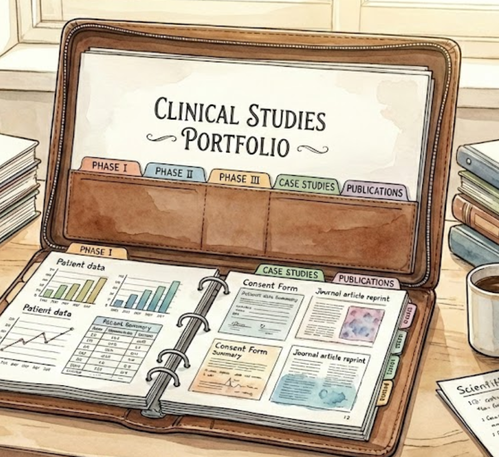
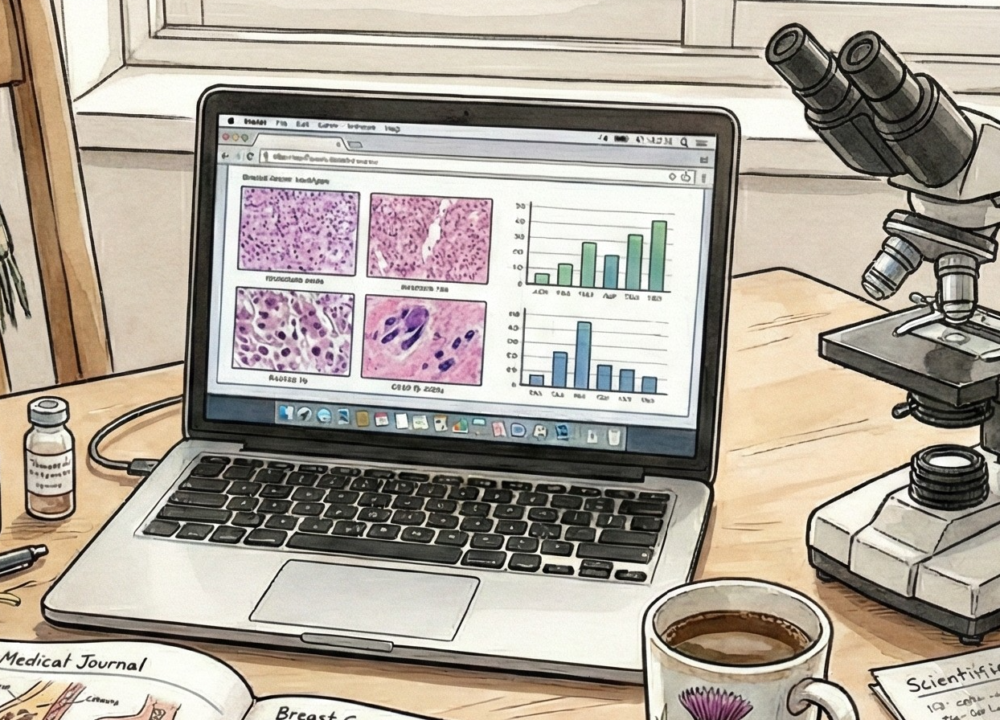

# Scottish Breast Studies Group

The Scottish Breast Studies Group is a multidisciplinary research collaborative for Scotland.

---



---

  

    
    <a href="/studies/">Current Studies</a>
  

  

    
    <a href="/about/">About Us</a>
  

  

    
    <a href="/webinars/">Webinars</a>
  

---

## Mailing List

To receive updates on collaborative research opportunities, webinars, and meetings, healthcare professionals may join our mailing list.

<a href="/join" class="network-link">Network mailing list information</a>

---

<section class="blog-feature" aria-labelledby="from-the-blog">
  
Guest perspective

  <h2 id="from-the-blog">From the blog</h2>
  <h3><a href="/blog/playing-with-other-peoples-data/">Playing with other people's data</a></h3>
  
Professor David Cameron

  
Two global cancer data collaborations use opposite approaches but point to the same priority: Scotland gains influence when it contributes good data through coordinated research.

  <a href="/blog/playing-with-other-peoples-data/" class="blog-feature-link">Read the article &rarr;</a>
</section>

<section class="blog-feature blog-feature--affiliated" aria-labelledby="affiliated-blog">
  
Affiliated blog

  <h2 id="affiliated-blog">From Edinburgh Cancer Informatics</h2>
  <h3><a href="https://edinburghcancerinformatics.org.uk/2026/11/23/scotland-breast-cancer-recurrence-rates/">Breast cancer recurrence in Scotland: the first national rates</a></h3>
  
Edinburgh Cancer Informatics Research Group, University of Edinburgh, led by Professor Peter Hall

  
Scotland's first national five-year recurrence rates, for women diagnosed in 2017: 1.3% in the same breast after breast-conserving surgery, 2.3% on the treated side after mastectomy, and 9.4% for any recurrence. The post argues that linking these figures to treatment, genomic and deprivation data would help to identify secondary breast cancer.

  <a href="https://edinburghcancerinformatics.org.uk/2026/11/23/scotland-breast-cancer-recurrence-rates/" class="blog-feature-link">Read on the Edinburgh Cancer Informatics blog &rarr;</a>
</section>

